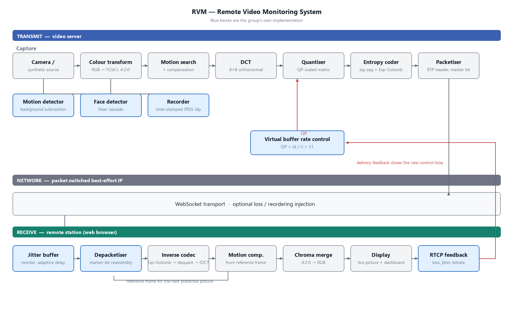

# RVM — Remote Video Monitoring

**EIE4428 Multimedia Communications (HK PolyU, 2026/27) — Mini Project**

A video server captures a scene, compresses it and streams it over the network to remote
stations, where an operator watches the live picture and live telemetry in an ordinary web
browser and is alerted when motion is detected.

The distinguishing feature: **the codec is written from scratch.** Rather than delegating
to WebRTC or an existing library, this project implements the full hybrid transform coding
pipeline taught in the course, so every stage the lectures describe is actually executed,
measured and tunable.



---

## Quick start

```powershell
# 1. Create the environment
python -m venv .venv
.\.venv\Scripts\python.exe -m pip install -e ".[dev]"

# 2. Run the server (no webcam needed -- uses a generated scene)
.\.venv\Scripts\python.exe run_server.py --no-camera --port 8099

# 3. Open http://localhost:8099
```

With a webcam: drop `--no-camera`, or select one with `--camera 1`.

Run the tests:

```powershell
.\.venv\Scripts\python.exe -m pytest          # 400 tests, ~10s
```

Measure the encoder on the machine you are going to demonstrate on:

```powershell
.\.venv\Scripts\python.exe tools\benchmark.py --width 320 --height 240
```

---

## What it does

| | |
|---|---|
| **Live video** | MJPEG stream in any browser; coded RTP-style packets observable over a WebSocket |
| **Codec** | `RVM1` — CCIR-601 4:2:0, motion compensation, 8×8 DCT, QP-scaled quantisation, zig-zag + Exp-Golomb |
| **Rate control** | TM5 virtual buffer, `Q = (d/r) × 31`, H.264 ±2 QP limiter, bpp starting-point model |
| **Transport** | RTP packetisation with marker bit, adaptive jitter buffer, RFC 3550 jitter recursion |
| **Analysis** | Motion detection with alarm + bounding box, Haar face detection, PSNR / SSIM |
| **Tracking** | Each moving object keeps an ID and a fading trail across frames — the motion mask is split into connected regions and matched by nearest centroid |
| **Detection zone** | Drag a box on the picture to watch only that area; three sensitivity levels. The zone lives on the server, so a reload or a second viewer sees the same one |
| **Clips** | Recording list with a thumbnail of each clip's first frame, served from `/api/clips/<clip>/<n>.jpg` |
| **Recording** | Timestamped colour JPEG clips written off the live path |
| **Concurrency** | Unlimited viewers; one encode feeds all of them |
| **Two views** | *Camera* shows the raw picture, *Decoded (RVM1)* shows what a receiver reconstructs from the bitstream — the codec's own distortion, visible rather than claimed |

### Measured results

Measured on the demonstration machine (Intel Core Ultra 9 185H, Python 3.13,
NumPy 2.5) at the default 320×240, with `tools/benchmark.py`:

| Metric | Value |
|---|---|
| Frame rate | about 20 pictures/s — bound by the Python encoder, not by the algorithm |
| Bit rate | about 200 kbit/s at that rate |
| PSNR (against the encoder's own reconstruction) | about 42 dB |
| Quantiser parameter | 1 — the 1.2 Mbit/s target is not the binding constraint |
| Dashboard API latency while coding | under 2 ms median over 20 requests (0.6–1.7 ms across runs) |
| 640×480 | supported, but about 3 pictures/s in Python |

The numbers a machine under load produces vary, so the benchmark reports the
**median** encode time rather than a wall-clock average: the cost of coding
one picture does not move, but the average does when something else is
running.

---

## Architecture

```
Capture ──► Colour transform ──► Motion search ──► DCT ──► Quantiser ──► Entropy ──► Packetiser ──┐
  (YUV 4:2:0)                     │                │                      ▲                          │
                                  │                │            Virtual buffer rate control           │
  Motion / Face / Recorder ────────┘                │                      │                          │
                                                                              └──── feedback ─────────┤
                                                                                                         ▼
    Display ◄── Chroma merge ◄── Inverse codec ◄── Motion comp. ◄── Depacketiser ◄── Jitter buffer ◄── WebSocket
                                                                                                 │
                                                                                    RTCP feedback ┘
```

`docs/figures/system_block_diagram.png` is the full-size version (blue = this group's own
implementation, grey = processing the standards specify).

The encoder runs in a worker thread, not in the event loop. Coding a picture
is tens of milliseconds of arithmetic, and doing that inside the loop would
stop the server answering the dashboard for exactly that long; the measured
API latency above is the evidence that it does not.

---

## HTTP / WebSocket API

| Method | Path | Purpose |
|---|---|---|
| `GET` | `/` | Operator dashboard |
| `GET` | `/api/status` | Resolution, fps, bit rate, QP, PSNR, keyframe count |
| `GET` | `/api/stream.mjpg` | Live MJPEG stream (`?view=source` or `?view=decoded`) |
| `GET` | `/api/snapshot.jpg` | Single JPEG snapshot (same `view` parameter) |
| `GET` | `/api/metrics` | Full telemetry as JSON |
| `GET` | `/api/clips` | List recorded clips |
| `POST` | `/api/config` | Set target bit rate without restarting the stream |
| `POST` | `/api/record` | Start / stop recording |
| `GET` | `/ws` | WebSocket telemetry push |

---

## Project layout

```
src/rvm/
  core/       colorspace.py   CCIR-601 YCbCr, 4:2:0 sub/upsampling
              bitstream.py    MSB-first bit reader/writer, sign-magnitude coding
  codec/      dct.py          separable orthonormal 8×8 DCT-II
              quant.py        JPEG base matrices × H.264 QP scaling
              entropy.py      zig-zag scan, Exp-Golomb ue/se, block coefficient coder
              motion.py       3-step global search + per-block refinement (RD-costed)
              ratecontrol.py  TM5 virtual buffer, GOP allocation, QP limiter
              video.py        VideoEncoder / VideoDecoder, RVM1 bitstream
  network/    packet.py       RTP header + packetiser / depacketiser
              jitter.py       adaptive jitter buffer
              stats.py        RFC 3550 jitter recursion + delivery feedback
  analysis/   quality.py      PSNR, SSIM
              detect.py       MotionDetector, FaceDetector
  server/     source.py       CameraSource, SyntheticSource
              session.py      StreamSession — one encode, many viewers
              recorder.py     FrameRecorder — timestamped JPEG clips
              app.py          aiohttp REST + WebSocket server
  web/        index.html, app.js, style.css
```

---

## Design notes

**Why write a codec from scratch?** The brief permits it, and it is the only way the
lecture material becomes something executable and measurable. It also removes the external
codec dependency entirely.

**Why is the browser picture path MJPEG?** A browser cannot decode `RVM1`. Rather than
pretending otherwise, the custom coded packets ride the WebSocket where they can be
observed, while the picture path stays something any browser renders natively. The
*Decoded* view closes the loop honestly: it serves the encoder's reconstruction — the
picture a receiver rebuilds from the bitstream — so the codec's own distortion is on
screen next to the camera picture instead of only in a table of numbers.

**Why one encode for all viewers?** A broadcast shape. Each extra viewer costs bandwidth,
not CPU. Every client holds a bounded *latest-only* queue — in a live monitoring feed, a
delivered backlog is worse than useless, because by the time a slow client works through it
the information is stale.

**Why the two-stage motion search?** A full ±8 per-block search benchmarked at ~50 ms/frame
at 320×240, which alone would cap the encoder near 20 fps before any other work. The
three-step global search plus per-block refinement costs a fraction of that for the same
pictures.

**Why is the encoder in a worker thread?** Because a monitoring system that stops answering
while it codes is not a monitoring system. Coding a picture is tens of milliseconds of
solid arithmetic; inside the event loop that time is stolen from the dashboard, the stream
and the telemetry. Measured with the pipeline running, the status endpoint answers in
under 2 ms (median) instead of timing out.

**Why rate control must be closed through PSNR?** QP is derived from buffer fullness, but
the number a user cares about is distortion. That loop is closed by measuring PSNR against
the encoder's own reconstruction — the picture the receiver actually displays.

**Known limitations (stated plainly):** video only, no audio; the custom codec is a
teaching implementation and is considerably less efficient than H.264, which adds larger
transform blocks, multiple reference frames, deblocking and intra prediction; frame rate is
bounded by Python rather than by the algorithm, and 640×480 is consequently not real time.

---

## Development

Every module was built test-first — tests were written before the implementation, and each
commit pairs the tests with the code that satisfies them.

```powershell
.\.venv\Scripts\python.exe -m pytest              # full suite
.\.venv\Scripts\python.exe -m pytest tests/test_video.py   # one module
.\.venv\Scripts\python.exe verify_system.py        # end-to-end live check
.\.venv\Scripts\python.exe tools\benchmark.py      # encoder measurement
```

`verify_system.py` runs the real application in-process and exercises it over HTTP and
WebSocket: page load, live stream, status, snapshot, both picture views, config, recording
and telemetry. It also measures the dashboard API latency while the pipeline is running.

`tools/benchmark.py` measures the encoder on the machine you are about to demonstrate on.
It reports the median encode time, because a laptop that is also running other applications
makes the wall-clock average wander while the cost of coding one picture does not.

### Report

```powershell
.\.venv\Scripts\python.exe tools\build_report.py     # fill the course DOCX template
.\.venv\Scripts\python.exe tools\verify_report.py    # structural check
```

Output: `docs/EIE4428-mini-project-report-RVM.docx` (built from the supplied template).

The group member rows carry `[Student ID]` placeholders until the names are
supplied. Give them on the command line — the name then appears on the cover
sheet *and* in the co-operation section, and the "to be completed" note
disappears by itself:

```powershell
.\.venv\Scripts\python.exe tools\build_report.py `
    --member "Chan Tai Man | 20075335D" `
    --member "Wong Siu Ming | 20075336E"
```

The build prints a reminder while the placeholders are still there, so a
half-finished report cannot be shipped by accident.

---

## Demonstration script

Five to seven minutes, in the order that shows the most with the least clicking.

1. Start the server on the machine with the camera; open the printed LAN address on the second PC. Say what the picture is: a remote station watching a place through an ordinary browser.
2. Move in front of the camera. The alarm overlay pulses and a red box follows the movement.
3. Drag a box around the doorway (or any corner), then move outside it: no alarm. Move inside it: alarm. Say that the zone is enforced on the server, so every viewer gets it.
4. Switch the sensitivity to *low*, wave again; switch back. Explain that the three levels trade false alarms against missed events.
5. Switch to **Decoded (RVM1)** and back. The picture barely changes, so the quality cost of the codec is visible instead of claimed. Point at PSNR and QP in the panel.
6. Open the dashboard a second time (another browser or a phone). Both viewers work, and the encoder cost did not change — one encode feeds everyone.
7. Start a recording, stop it, and show the clip appearing in the Clips panel with its thumbnail. Explain that frames are timestamped and written off the live path.

## Before submission

- [ ] Group member names and student IDs in the report (the build refuses silently to be complete otherwise).
- [ ] Report exported and read once end to end — the division of effort must match what actually happened.
- [ ] `pytest`, `verify_system.py` and `tools/benchmark.py` run on the machine that will be used for the demonstration; numbers in the report match that run.
- [ ] Real camera tried on that machine, with Teams / Zoom / the Camera app closed.
- [ ] Second PC connects over the LAN address, not `localhost`, and the firewall rule is in place.
- [ ] `mini-project/EIE4428-RVM.zip` rebuilt with `tools/make_zip.py`, which unpacks its own output and runs the test suite there.
- [ ] Test recordings containing private material deleted before zipping.
